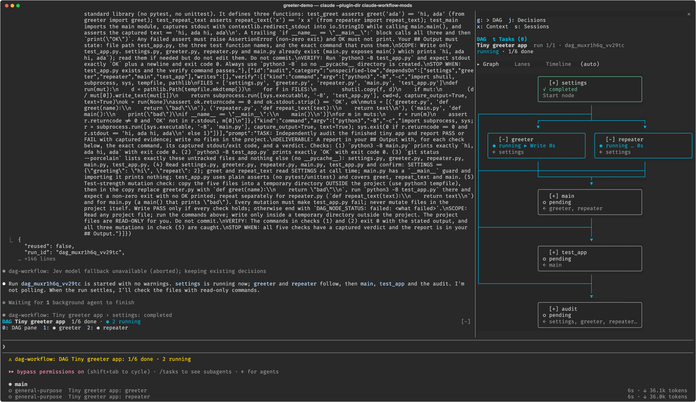

# claude-dag-workflow

Claude Code의 작업을 의존성 그래프(DAG)로 나누어 실행하는 Mod 플러그인입니다.
독립된 작업은 병렬로 실행하고, 선행 작업이 끝나면 그 결과를 다음 작업에 전달합니다.

- **병렬 실행:** Claude Code 서브에이전트가 의존 관계에 따라 작업합니다.
- **결과 검증:** 노드마다 정해 둔 검사를 통과해야 완료로 처리합니다.
- **진행 상황 표시:** DAG 패널에서 작업 상태와 의존 관계를 확인합니다.

## 실행 화면



선행 작업인 `settings`가 끝난 뒤 `greeter`와 `repeater`가 병렬로 실행되는 화면입니다.
오른쪽 패널은 작업별 상태와 의존 관계를, 프롬프트 위 밴드는 현재 진행 상황을 보여 줍니다.

## 빠른 시작

Claude Code **v2.1.287 이상(Claude Mods 기능 활용)**이 필요합니다.  
이 저장소를 내려받은 뒤, 작업할 프로젝트 디렉터리에서 플러그인을 불러옵니다.

```bash
claude --plugin-dir /path/to/this-repo
```

`/path/to/this-repo`는 이 저장소의 실제 경로로 바꿉니다.  
모든 세션에 적용하려면 [전역 불러오기 설정](docs/reference.md#불러오기)을 참고하세요.

이후에는 평소처럼 요청합니다.   
DAG를 직접 작성하거나 별도로 실행을 지시할 필요는 없습니다.

```text
설정 파일을 공유하는 인사 함수와 텍스트 반복 함수를 만들고,
두 함수를 사용하는 CLI와 테스트까지 작성해줘.
```

기본 `auto` 모드에서는 요청에 따라 직접 실행하거나 DAG로 나눕니다.
DAG로 실행하면 진행 알림이 나오고, 실행이 끝나면 노드별 결과와 검증 요약이 대화에 전달됩니다.

## 기본 사용법

### 진행 확인

```text
/dag                        DAG 패널 열기
/dag list                   이 프로젝트의 실행 목록
/dag status <run_id>        실행의 노드별 상태
```

패널에서는 그래프·레인·타임라인 보기를 선택할 수 있습니다.
패널을 닫아도 프롬프트 주변에 진행 상황이 표시됩니다. `Esc`로 프롬프트로 돌아갑니다.

패널은 터미널과 데스크톱에서 표시되며, 다른 화면에서는 진행·완료 메시지를 텍스트로 받습니다.

### 취소와 재시도

```text
/dag cancel <run_id>           실행 취소
/dag retry <run_id> [node...]  실패·취소된 노드 다시 실행
```

노드가 실패하면 그 결과가 필요한 후속 작업은 시작하지 않고, 관계없는 작업은 계속 실행합니다.
재시도할 때 이미 완료된 노드의 결과는 재사용합니다.

### 정의 파일 실행

직접 작성한 DAG는 JSON 또는 YAML 파일로 실행할 수 있습니다.

```text
/dag preview <file>          실행 전 계획·쓰기 충돌·경고 확인
/dag run <file>              정의 파일 실행
```

작성 예제와 필드는 [정의 형식](docs/reference.md#정의-형식)을 참고하세요.

## 실행 방식과 주요 설정

설정은 `/config`의 플러그인 항목에서 바꿉니다.
실행 방식은 `/dag enforce <모드>`로 현재 세션에서도 변경할 수 있습니다.

### 실행 방식

- **`auto` (기본):** Jev가 요청마다 판단합니다. 작은 요청은 직접 실행하고, 노드가 셋 이상 필요하며 병렬·격리 실행이 유리한 요청은 DAG로 실행합니다.
- **`strict`:** 실제 작업은 모두 DAG 노드에서 실행합니다. 메인 대화는 계획·읽기·질문·실행 관리만 담당합니다.
- **`guide`:** DAG 사용을 안내하지만 메인 대화의 도구 사용을 제한하지 않습니다.
- **`off`:** DAG 강제와 관련 안내를 끕니다.

`auto`에서 판단이 불확실하거나 실패하면 직접 실행합니다.
단, 현재 세션에 아직 끝나지 않은 실행이 있으면 DAG 방식으로 유지합니다.

### 자주 바꾸는 설정

- **`language`:** 패널 언어. 기본 `en`, 한국어는 `ko`.
- **`max_concurrent`:** 실행 하나에서 동시에 작업할 노드 수. 기본 `8`.
- **`start_approval`:** 기본 `off`. `always`로 설정하면 대화형 세션에서 모델이 시작한 실행은 사용자 승인을 기다립니다.
- **`auto_recovery`:** 기본 `true`. 조건에 맞는 실패를 자동으로 복구합니다.

시작 승인을 켰다면 패널 버튼이나 `/dag approve <run_id>`로 승인하고,
`/dag reject <run_id> [reason]`으로 거절합니다.
직접 입력한 `/dag run`과 비대화형 세션은 시작 승인을 기다리지 않습니다.

### 자동 판단과 사용량

Typesafe 의 Jev(System One Model)는 실행 방식, 노드의 모델 등급, 도구 승인, 실패 복구를 판단합니다.  
`TYPESAFE_API_KEY`가 있으면 TypeSafe API를 사용하고,
키가 없거나 API가 실패하면 기본적으로 세션의 Sonnet 모델을 사용합니다.
**세션 모델의 판단 호출은 사용자의 Claude 요금제 사용량에 포함됩니다.**

자세한 동작은 [자동 판단](docs/reference.md#jev-를-활용한-자동-판단),
전체 옵션은 [설정 레퍼런스](docs/reference.md#설정)를 참고하세요.

### 사용 중 알아둘 점

- 노드가 긴 명령을 실행 중이라면 `/clear` 대신 `/compact`를 사용하세요. `/clear`는 실행 중인 셸을 종료할 수 있습니다.
- 패널에 포커스가 있으면 권한 확인 창에 답하기 전에 `Esc`로 프롬프트로 돌아가세요.
- 실행 기록과 보고서는 프로젝트의 `.claude/dag/`에 저장되며, 기본 보관 기간은 14일입니다. 이 폴더는 자동으로 git에서 제외됩니다.

## 상세 문서

- [사용법과 설정 레퍼런스](docs/reference.md): 전체 명령, DAG 정의, 검증, 검토·보안 검토, 복구, 세션 인계, 패널 조작.
- [개발 안내](docs/development.md): 개발 규칙, 검사 명령, DAG 형태 평가.
- [상태줄 HUD](docs/statusline.md): 플러그인과 별도로 설치하는 상태줄과 Orca 연동.
